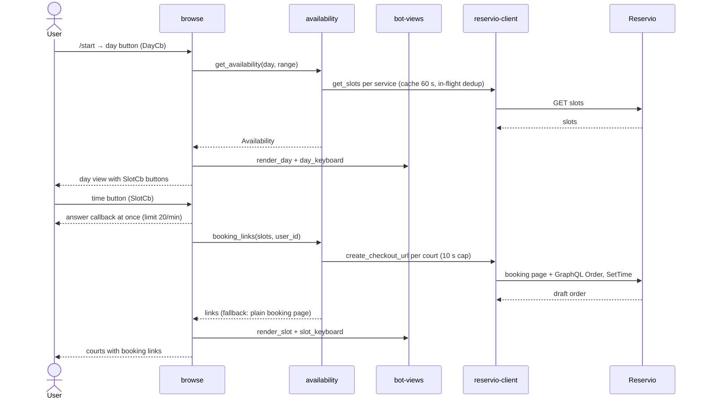
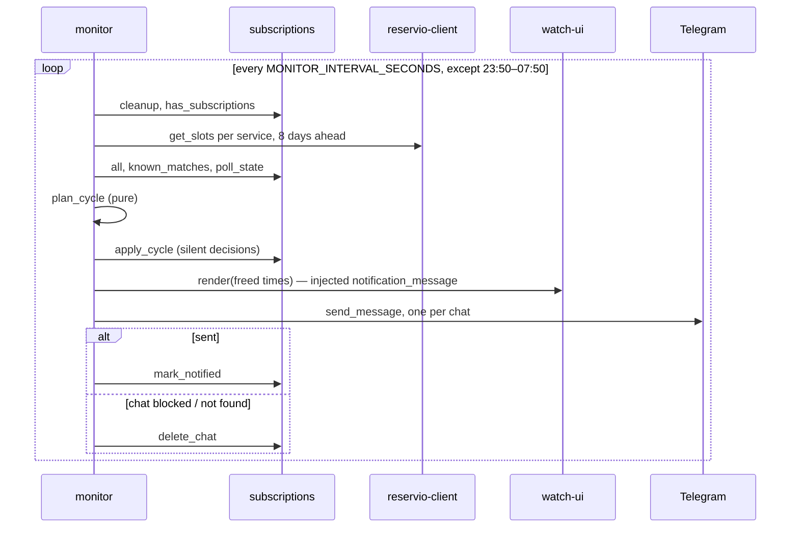
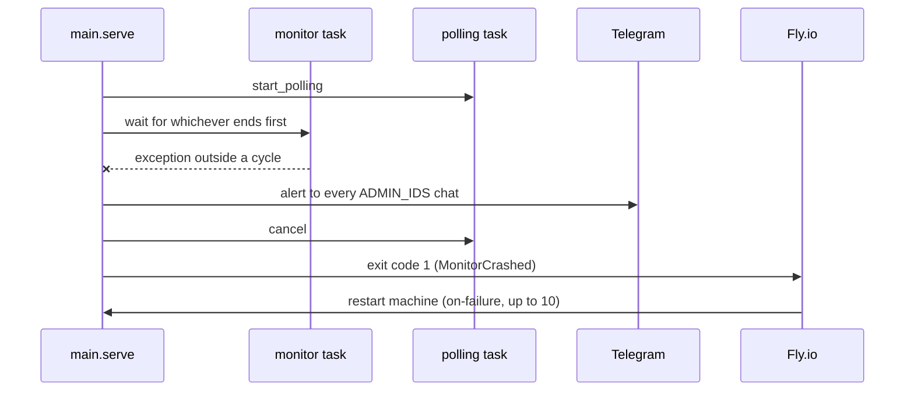

# Key flows — sequence diagrams

Companion to [index.md](index.md) "Key flows": the same paths, as who-calls-whom in order.
Participants are blocks from the index; shared helpers (`bot/common.py`, `domain.py`) are omitted.

## User taps a time slot (main path)

## Freed court notification (background path)

## Monitor crash (edge path)

