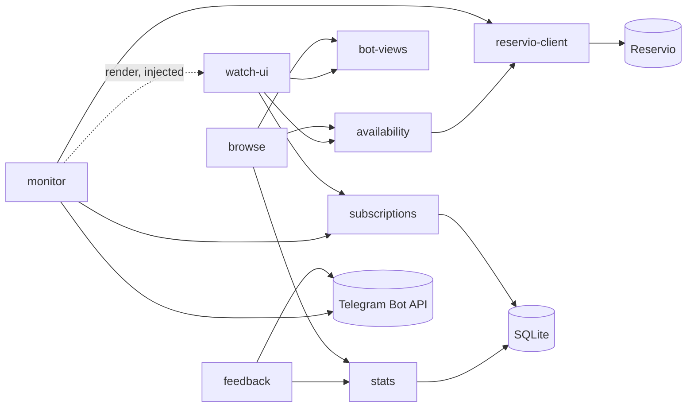

# Block map — padel-bot

Built at commit `f8ab2cf` on 2026-10-05, updated at `c736366` on 2026-10-15. Working tree was clean.
Update with `/repo-blocks update`.

Telegram bot that shows free padel courts in two Batumi clubs (Reservio) and gives booking links that open a pre-filled draft order; users can subscribe to a day/hour and get notified when a booked court is freed. One Python 3.14 process (aiogram long polling + an asyncio monitor task) with one SQLite file, deployed as a single Fly.io machine. Small repo (~2.9k source lines): all source was read.

## Blocks
| Block | Purpose | Code |
|---|---|---|
| [reservio-client](reservio-client.md) | HTTP to Reservio: free slots, draft orders | `padel_bot/reservio/client.py` |
| [availability](availability.md) | Slots for a play day across venues, caches, per-user booking links | `padel_bot/reservio/service.py` |
| [browse](browse.md) | Day → slots → booking links flow; slots-only view in groups, fallback router | `padel_bot/bot/browse.py` |
| [bot-views](bot-views.md) | Message texts, keyboards, callback-data contracts | `padel_bot/bot/formatting.py`, `padel_bot/bot/keyboards.py` |
| [watch-ui](watch-ui.md) | Subscription screens: hour grid, card, `/watch`, `/subs` | `padel_bot/bot/watch.py` |
| [subscriptions](subscriptions.md) | Subscription model and SQLite store (matches, poll state) | `padel_bot/monitoring/models.py`, `padel_bot/monitoring/store.py` |
| [monitor](monitor.md) | Background polling, freed-slot rule, notifications | `padel_bot/monitoring/matcher.py`, `padel_bot/monitoring/poller.py` |
| [feedback](feedback.md) | `/feedback` forwarding to admins | `padel_bot/bot/feedback.py` |
| [stats](stats.md) | Anonymous usage stats and admin summary | `padel_bot/stats.py` |

## Diagram

Inbound Telegram updates reach handlers through the dispatcher (see Wiring); `watch-ui --> stats`, type-only edges and the shared `bot/common.py` helpers are omitted.

## Key flows
Sequence diagrams: [flows.md](flows.md).
### User taps a time slot (main path)
1. browse — `/start` or `/days` → `days_keyboard`; `DayCb` → `build_day_view`.
2. availability — `get_availability`: parallel `get_slots` per service, cached 60 s, in-flight dedup.
3. bot-views — `render_day` + `day_keyboard` (one `SlotCb` button per start time).
4. browse — `on_slot`: rate limit 20/min, answer the callback first, re-read availability.
5. availability — `booking_links`: per user, `create_checkout_url` per court (10 s cap, else plain booking page).
6. reservio-client — `GET /booking?step=2` → GraphQL `Order` + `SetTime` → link to the order's time step.

### Freed court notification (background path)
1. monitor — `Poller.run` sleeps through 23:50–07:50, then `run_cycle`; subscriptions `cleanup`.
2. reservio-client — `get_slots` for every service, 8 days ahead.
3. monitor — `plan_cycle` with known matches and `poll_state` from subscriptions; `apply_cycle` writes silent decisions.
4. monitor — one message per chat, rendered by the injected watch-ui `notification_message` (bot-views texts + `SlotCb` buttons); `mark_notified` only after a successful send.
5. User taps a button → browse `on_slot` (main path from step 4).

### Reservio fails or user blocks the bot (edge path)
1. availability — a failed service marks its venue in `failed_venues`; bot-views shows "⚠️ club: failed"; on a slot tap browse says "club didn't answer" instead of "taken".
2. monitor — a club with any failed service is skipped; all services failed → backoff ×2 up to 1 h, `Retry-After` honoured.
3. monitor — `TelegramForbiddenError` / "bot was blocked" → subscriptions `delete_chat`.
4. monitor task dies (bug outside a cycle) → `main.serve` alerts `ADMIN_IDS`, stops polling, exits with code 1 → Fly restarts the machine.

## Wiring
`padel_bot/main.py` (`padel-bot` script): settings → logging → `load_venues(venues.yaml)` → one `ReservioClient` → `AvailabilityService` → `Bot` (HTML parse mode) → `db.connect` → `Stats` + `SubscriptionStore` on the same connection → `build_dispatcher`: `StatsMiddleware` (outer, messages + callbacks), routers in order `browse_router`, `group_browse_router`, `watch_router`, `feedback_router`, `fallback_router` → command menu en/ru from `COMMAND_KEYS` (`HIDDEN_COMMANDS` stay off it) → `Poller(render=notification_message)` task if `MONITOR_ENABLED` → `serve`: `start_polling` injecting `availability`, `stats`, `subscriptions`, `admin_ids`, three `RateLimiter`s, while watching the monitor task (crash → admin alert, `MonitorCrashed`, exit 1). Shutdown cancels the monitor, closes the HTTP client, bot session and DB. Covered by `tests/test_main.py`.

## Shared
**Not in blocks:** `padel_bot/main.py`, `padel_bot/domain.py`, `padel_bot/bot/common.py`, `padel_bot/config.py`, `padel_bot/db.py`, `padel_bot/reservio/models.py`, `padel_bot/bot/i18n.py`, `padel_bot/bot/throttle.py`, `scripts/`
- `padel_bot/main.py` — composition root, see Wiring.
- `padel_bot/domain.py` — shared domain without project imports: `TZ` (Asia/Tbilisi), play day (`DAY_START`, `current_play_day`, `TimeRange`, `WHOLE_DAY`), `Lang`, `detect_lang`. Tests: `tests/test_play_day.py`, `tests/test_service.py`, `tests/test_i18n.py`.
- `padel_bot/bot/common.py` — handler helpers: `private_router`, `group_router` (groups, bot's own messages), `link_target` (bot username in groups, else None), `lang_of`, `answer_quietly`, `safe_edit`, `resolve_day` (checks that the callback message is accessible and returns it with the day), `build_day_view`.
- `padel_bot/config.py` — `Settings` (env: `BOT_TOKEN`, `LOG_LEVEL`, `CACHE_TTL_SECONDS`, `ADMIN_IDS`, `STATS_SALT`, `STATS_DB_PATH`, `MONITOR_*`, `VENUES_FILE`, `RESERVIO_API_URL`), `load_venues`.
- `venues.yaml` — clubs, courts, Reservio service ids and prices (data, not code).
- `padel_bot/db.py` — one SQLite connection (WAL, foreign keys) for stats and subscriptions.
- `padel_bot/reservio/models.py` — shared types: `Venue`, `CourtConfig`, `ServiceConfig`, `RawSlot`, `CourtSlot` (+ fallback `booking_url`).
- `padel_bot/bot/i18n.py` — ru/en texts, calendar names.
- `padel_bot/bot/throttle.py` — in-memory sliding-window `RateLimiter` per user id.
- `scripts/dump_services.py` — prints a club's services from its booking page for `venues.yaml`.
- `scripts/show_slots.py` — prints availability from the live API without Telegram.
- CI: `.github/workflows/ci.yml` (ruff + pytest on push/PR). Deploy: `deploy.yml` (`workflow_dispatch` → `flyctl deploy`) fails without the `FLY_API_TOKEN` repo secret, which is not set; deploys are done locally with `fly deploy --ha=false` (owner, 2026-10-05).

## Smells & questions
Resolved at `6db348e`: package cycles (shared types moved to `domain.py`, monitor rendering injected, plan types in `monitoring/models.py`), `_dedupe` across blocks, `/days` menu gap, `/stats` in groups, handler helpers inside browse, missing wiring test, silent monitor crash, stale plans (now marked historical) and `deploy.yml` comment.

- In-process state assumes one instance — caches in `reservio/service.py`, limiters (`main.py`), feedback waits (`bot/feedback.py`), the poller; covered by the single-machine rule in `fly.toml` and README.
- Two independent Reservio paths: buttons via the `AvailabilityService` cache, the monitor directly for 8 days — a recorded decision (`PLAN_MONITORING.md`, README); first place to look if Reservio rate-limits.
- `stats.py` mixes storage, aiogram middleware and admin presentation; event names are free strings *(inferred)*.
- Subscription toggle rules live in the UI (`bot/watch.py`) rather than next to the model *(inferred)*.
- Restart on monitor crash relies on Fly `on-failure` with 10 retries: a crash-loop would leave the machine stopped *(verify whether that is acceptable)*.
