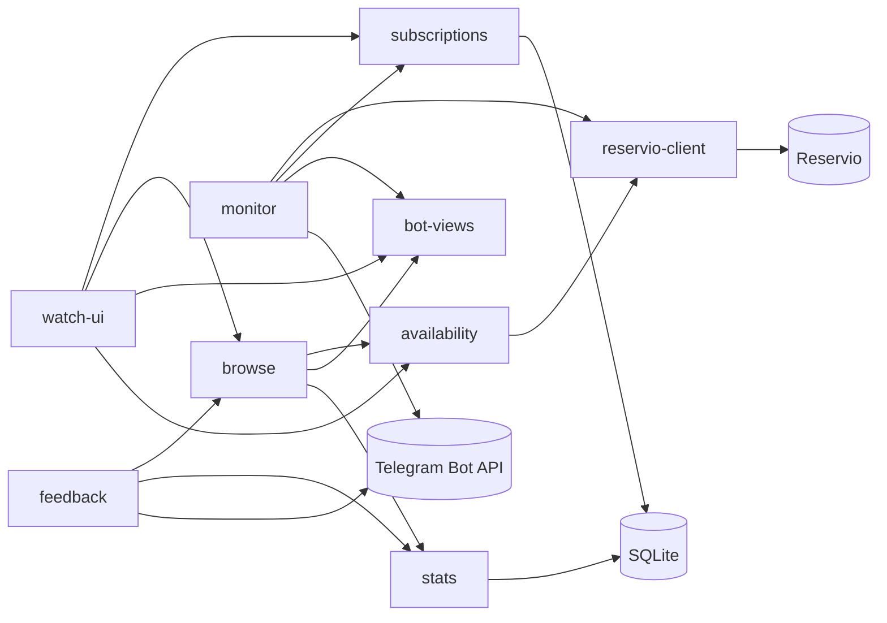

# Block map — padel-bot

Built at commit `f8ab2cf` on 2026-10-05. Working tree was clean.
Update with `/repo-blocks update`.

Telegram bot that shows free padel courts in two Batumi clubs (Reservio) and gives booking links that open a pre-filled draft order; users can subscribe to a day/hour and get notified when a booked court is freed. One Python 3.14 process (aiogram long polling + an asyncio monitor task) with one SQLite file, deployed as a single Fly.io machine. Small repo (~2.9k source lines): all source was read.

## Blocks
| Block | Purpose | Code |
|---|---|---|
| [reservio-client](reservio-client.md) | HTTP to Reservio: free slots, draft orders | `padel_bot/reservio/client.py` |
| [availability](availability.md) | Slots for a play day across venues, caches, per-user booking links | `padel_bot/reservio/service.py` |
| [browse](browse.md) | Day → slots → booking links flow, private routing, shared handler helpers | `padel_bot/bot/handlers.py` |
| [bot-views](bot-views.md) | Message texts, keyboards, callback-data contracts | `padel_bot/bot/formatting.py`, `padel_bot/bot/keyboards.py` |
| [watch-ui](watch-ui.md) | Subscription screens: hour grid, card, `/watch`, `/subs` | `padel_bot/bot/watch.py` |
| [subscriptions](subscriptions.md) | Subscription model and SQLite store (matches, poll state) | `padel_bot/monitoring/models.py`, `padel_bot/monitoring/store.py` |
| [monitor](monitor.md) | Background polling, freed-slot rule, notifications | `padel_bot/monitoring/matcher.py`, `padel_bot/monitoring/poller.py` |
| [feedback](feedback.md) | `/feedback` forwarding to admins | `padel_bot/bot/feedback.py` |
| [stats](stats.md) | Anonymous usage stats and admin summary | `padel_bot/stats.py` |

## Diagram

Inbound Telegram updates reach handlers through the dispatcher (see Wiring); `watch-ui --> stats` and type-only edges (`bot-views`/`monitor`/`subscriptions` → availability types) are omitted.

## Key flows
### User taps a time slot (main path)
1. browse — `/start` or `/days` → `days_keyboard`; `DayCb` → `build_day_view`.
2. availability — `get_availability`: parallel `get_slots` per service, cached 60 s, in-flight dedup.
3. bot-views — `render_day` + `day_keyboard` (one `SlotCb` button per start time).
4. browse — `on_slot`: rate limit 20/min, answer the callback first, re-read availability.
5. availability — `booking_links`: per user, `create_checkout_url` per court (10 s cap, else plain booking page).
6. reservio-client — `GET /booking?step=2` → GraphQL `Order` + `SetTime` → link to the order's time step.

### Freed court notification (background path)
1. monitor — `Poller.run` sleeps through 23:50–07:50, then `run_cycle`; subscriptions `cleanup`.
2. reservio-client — `get_slots` for every service, 8 days ahead.
3. monitor — `plan_cycle` with known matches and `poll_state` from subscriptions; `apply_cycle` writes silent decisions.
4. monitor — one message per chat via bot-views `render_notification` + `notification_keyboard`; `mark_notified` only after a successful send.
5. User taps a button → browse `on_slot` (main path from step 4).

### Reservio fails or user blocks the bot (edge path)
1. availability — a failed service marks its venue in `failed_venues`; bot-views shows "⚠️ club: failed"; on a slot tap browse says "club didn't answer" instead of "taken".
2. monitor — a club with any failed service is skipped; all services failed → backoff ×2 up to 1 h, `Retry-After` honoured.
3. monitor — `TelegramForbiddenError` / "bot was blocked" → subscriptions `delete_chat`.

## Wiring
`padel_bot/main.py` (`padel-bot` script): settings → logging → `load_venues(venues.yaml)` → one `ReservioClient` → `AvailabilityService` → `Bot` (HTML parse mode) → `db.connect` → `Stats` + `SubscriptionStore` on the same connection → `Dispatcher` with `StatsMiddleware` (outer, messages + callbacks) → routers in order `router` (browse), `watch_router`, `feedback_router`, `group_router` → command menu en/ru from `COMMAND_KEYS` → `Poller` task if `MONITOR_ENABLED` → `start_polling` injecting `availability`, `stats`, `subscriptions`, `admin_ids`, three `RateLimiter`s. Shutdown cancels the monitor, closes the HTTP client, bot session and DB.

## Shared
**Not in blocks:** `padel_bot/main.py`, `padel_bot/config.py`, `padel_bot/db.py`, `padel_bot/reservio/models.py`, `padel_bot/bot/i18n.py`, `padel_bot/bot/throttle.py`, `scripts/`
- `padel_bot/main.py` — composition root, see Wiring.
- `padel_bot/config.py` — `Settings` (env: `BOT_TOKEN`, `LOG_LEVEL`, `CACHE_TTL_SECONDS`, `ADMIN_IDS`, `STATS_SALT`, `STATS_DB_PATH`, `MONITOR_*`, `VENUES_FILE`, `RESERVIO_API_URL`), `TZ` (Asia/Tbilisi), `load_venues`.
- `venues.yaml` — clubs, courts, Reservio service ids and prices (data, not code).
- `padel_bot/db.py` — one SQLite connection (WAL, foreign keys) for stats and subscriptions.
- `padel_bot/reservio/models.py` — shared types: `Venue`, `CourtConfig`, `ServiceConfig`, `RawSlot`, `CourtSlot` (+ fallback `booking_url`).
- `padel_bot/bot/i18n.py` — ru/en texts, `Lang`, `detect_lang`, calendar names.
- `padel_bot/bot/throttle.py` — in-memory sliding-window `RateLimiter` per user id.
- `scripts/dump_services.py` — prints a club's services from its booking page for `venues.yaml`.
- `scripts/show_slots.py` — prints availability from the live API without Telegram.
- CI: `.github/workflows/ci.yml` (ruff + pytest on push/PR). Deploy: manual `deploy.yml` (`workflow_dispatch` → `flyctl deploy`) is the real path (owner, 2026-10-05).

## Smells & questions
- Shared domain types live inside blocks — `Lang`/`detect_lang` in `bot/i18n.py` are imported by `monitoring/models.py:4`, `monitoring/store.py:12`, `stats.py:23`; `TZ` in `config.py` while `config.py:10` imports `reservio.models.Venue`. These drive the depth-2 group cycles `bot <-> monitoring`, `bot <-> stats`, `config <-> reservio` (no import-time cycles).
- Background block depends on the UI layer — `monitoring/poller.py:19-20` imports `bot.formatting.render_notification` and `bot.keyboards.notification_keyboard`, while `bot/watch.py` imports `monitoring.store`: the `bot <-> monitoring` cycle mixes layers.
- Private name across blocks — `monitoring/matcher.py:28` imports `_dedupe` from `reservio/service.py` (planned that way in `PLAN_MONITORING.md` "Шаги реализации" 3).
- `/days` handled (`bot/handlers.py:110`, `:239`) but missing from the menu `COMMAND_KEYS` (`main.py:25`) and i18n `cmd_days` — a gap, `/days` is for everyone (owner, 2026-10-05). `/stats` off-menu is intended (owner, 2026-10-05).
- Store ↔ monitor type coupling — `monitoring/store.py:14` imports `CyclePlan` from the matcher, and the monitor uses the store.
- Helpers for all handlers live in browse — `bot/watch.py:15`, `bot/feedback.py:23` import `private_router`, `safe_edit`, etc. from `bot/handlers.py`.
- In-process state assumes one instance — caches in `reservio/service.py:61-64`, limiters (`main.py:74-76`), feedback waits (`bot/feedback.py:37-39`), the poller; covered by the single-machine rule in `fly.toml` and README.
- Docs vs code (plans are hints, "living, but already implemented" (owner, 2026-10-05)): `PLAN.md` "Деплой" says GitHub Action on push to `main`, code has manual `workflow_dispatch`; `PLAN.md` "Статус" still lists deploy as pending; `PLAN.md` mentions `/week` and `python -m padel_bot.reservio.service --date`, neither exists (`scripts/show_slots.py` replaced the latter). `deploy.yml` comment "Enable after `fly launch`" may be stale *(verify)*.
- No test for the wiring (`main.py`: router order, menu commands) — the `/days` gap above would have been caught by one.
- Question: the group fallback lists `stats` among commands it redirects to private chat (`bot/handlers.py:239`) — fine for an admin-only command, or should it stay silent in groups? *(verify)*
- Question: is the `monitor` crash-outside-cycle case (logged only, `main.py:28`) acceptable, or should it restart the task / exit the process so Fly restarts it? *(verify)*
